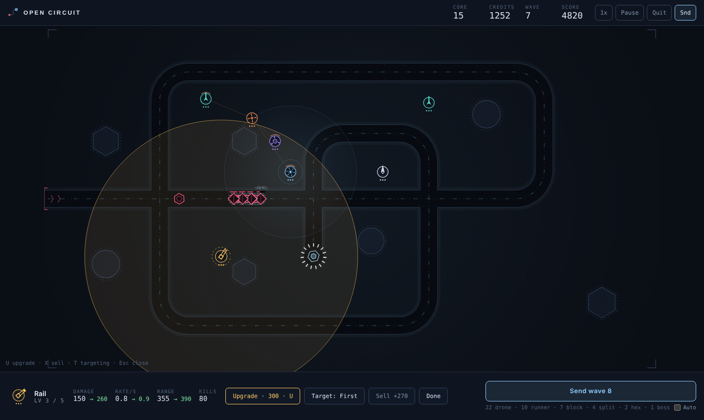

# Open Circuit

A tower defense game with no grid. Bots follow a trace to your core, and you build towers anywhere the trace, the voids and your other towers leave room.

**[Play the demo](https://mpragliola.github.io/open-circuit-tower-defense/)**



## How it plays

- Send a wave, earn credits for every bot you stop, and spend them on new towers or upgrades.
- A bot that reaches the core costs lives (bigger bots cost more). Run out and the run ends.
- Placement is free-form. The ghost tower follows the cursor, shows its range, and turns red with the reason when a spot is not allowed: on the trace, on a void, overlapping a tower, too close to the core or out of bounds.
- Clicking a tower always selects it, so upgrading never clashes with placing.

### Towers

Each tower has 5 levels.

| Key | Tower | Cost | Role |
|---|---|---|---|
| 1 | Pulse | 60 | Rapid single-target fire |
| 2 | Rail | 150 | Piercing beam with the longest range |
| 3 | Arc | 110 | Chain lightning that jumps between bots |
| 4 | Mortar | 130 | Area splash. Shells are aimed ahead of the target |
| 5 | Stasis | 85 | Slows bots in range and burns through armor |
| 6 | Lance | 140 | Continuous beam that ramps up the longer it stays on one target |
| 7 | Amp | 100 | Does not shoot. Boosts the damage of towers in range |

### Bots

Drone, Runner (fast), Block (armored), Splitter (breaks into drones), Hex (heavy armor) and a Boss every 8 waves. Health, armor and speed grow with each wave.

### Maps

Nine maps, from open fields to crossing traces: Meander, Inward, Switchback, Ripple, Outbound, Gauntlet, Knot, Labyrinth and Tangle. On Knot and Tangle the trace crosses itself, so a tower at a crossing covers two passes.

### Difficulty

| | Bot health | Kill rewards | Lives | Starting credits |
|---|---|---|---|---|
| Normal | x1 | x1 | x1 | x1 |
| Hard | x1.5 | x0.8 | x0.75 | x0.8 |
| Brutal | x2.2 | x0.65 | x0.5 | x0.7 |

Your best wave per map and difficulty is stored in the browser (`localStorage`).

## Controls

| Input | Action |
|---|---|
| `1`-`7` | Pick a tower to build |
| Click | Place the armed tower, or select a tower under the cursor |
| `U` | Upgrade the selected or hovered tower |
| `X` | Sell the selected tower (60% refund) |
| `T` | Cycle targeting: First, Last, Strongest, Closest |
| `N` | Send the next wave |
| `F` | Speed up: 1x, 2x, 3x, 5x, 8x, 12x, 16x, 24x. `Shift+F` or right-click on the button goes back |
| `Space` | Pause |
| `M` | Mute |
| `Esc` | Cancel placement and deselect |
| Right-click | Cancel placement |

On touch screens, tap once to aim a tower and tap again to place it.

## Run locally

The game is static and has no build step or dependencies. Open `index.html` in a browser, or serve the folder:

```bash
python3 -m http.server 8000
```

then visit `http://localhost:8000`.

## Project layout

| File | Contents |
|---|---|
| `index.html` | Page markup: top bar, canvas stage, build tray and menus |
| `style.css` | Colors, type and layout |
| `game.js` | Maps, bots, towers, simulation, rendering, audio and input |

Maps are entries in the `MAPS` array in `game.js`. A map is either a list of turtle commands (`cmds`: straights and arcs) or a list of waypoints (`poly`) joined with rounded corners, plus `obs` for the voids.

## Deployment

Pushing to `main` runs `.github/workflows/deploy-pages.yml`, which copies the three source files and publishes them to this repository's `gh-pages` branch. GitHub serves that branch at `/open-circuit-tower-defense/` under the account's Pages domain, so the site lives in its own subfolder and does not affect the sites of other repositories. The workflow uses `keep_files`, so existing files on the branch are never wiped.

One-time setup after the first workflow run: in **Settings > Pages**, set the source to **Deploy from a branch**, branch `gh-pages`, folder `/ (root)`.
